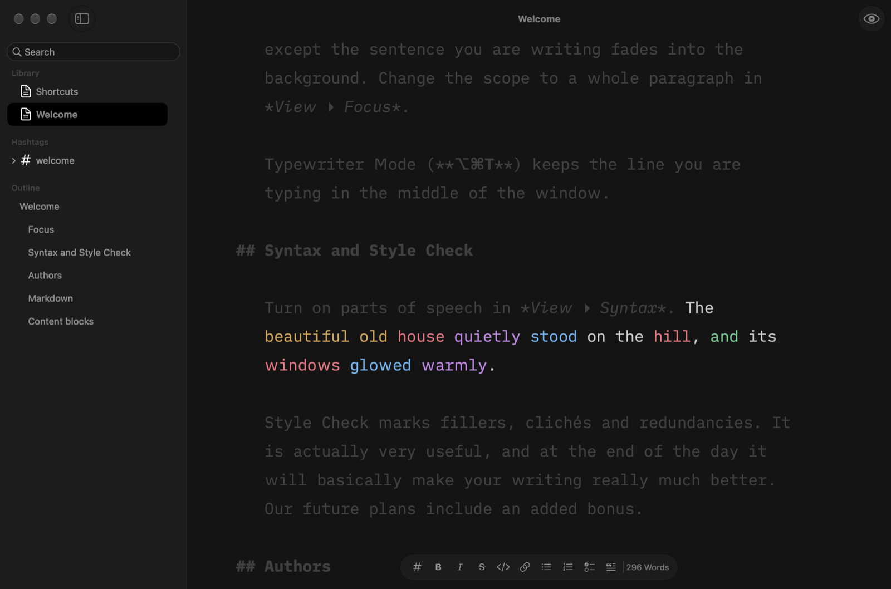
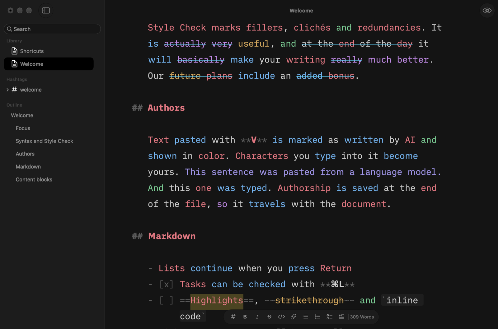

<h1 align="center">Writer</h1>

<p align="center">
  <b>A Markdown editor that gets out of your way.</b><br>
  No font picker. No margins to drag. No toolbar to configure.<br>
  Just you, a blinking caret, and a suspicious number of adverbs.
</p>

<p align="center">
  
  
  
  <a href="https://github.com/sam-b-rose/writer-web"></a>
</p>

<p align="center">
  
</p>

Writer is a native AppKit take on iA Writer: plain text in, calm typography out. It's fast, it's small, and it never asks you to sign in. The browser version lives in [writer-web](https://github.com/sam-b-rose/writer-web).

## Install

```sh
brew tap sam-b-rose/writer-mac https://github.com/sam-b-rose/writer-mac
brew install --cask sam-b-rose/writer-mac/writer
```

Or build it yourself. All you need is the Xcode Command Line Tools (no Xcode, no drama):

```sh
./build.sh && open build/Writer.app
```

The first launch creates `~/Documents/Writer` with a welcome document. Pick another folder with File ▸ Choose Library Folder.

## Tour

### Focus Mode (⌘D)

Everything except the sentence you're writing fades out. Your inner editor can wait its turn. Widen the scope to a paragraph in *View ▸ Focus*, and pin the active line to the middle of the window with Typewriter Mode (⌥⌘T).

<p align="center"></p>

### Syntax highlighting for your prose

Parts of speech get their own colors, so you can see at a glance that you wrote nine adjectives in a row. Style Check then strikes through fillers, clichés and redundancies, like "at the end of the day" and "basically". It's rude, and it's right.

Paste with ⇧⌘V and the text is marked as AI-written and shown in color. Anything you type into it becomes yours. Authorship is saved in the file itself, so it travels with the document.

<p align="center"></p>

### Preview (⌘R)

A WebKit preview with KaTeX math, footnotes, callouts, tables, task lists and content blocks. Drop a `.css` file into the templates folder for your own look.

<p align="center"></p>

### And the rest

- Library sidebar with search, hashtags and a live outline
- Wiki-style links between notes: `[[Shortcuts]]`
- Tables you can Tab through, sort and align
- `/file.md` embeds Markdown, images, CSV and code
- iA Writer Mono, Duo and Quattro bundled in
- Export to HTML, PDF and Word
- Light and dark, because of course

## Customizing

- Preview templates: drop a `.css` file into `~/Library/Application Support/Writer/Templates`; it appears under View ▸ Template.
- Style Check: View ▸ Style Check ▸ Edit Custom Patterns, one phrase per line.
- Authorship is stored in a footer block at the end of each file (`Annotations:` with a SHA-256 of the text). If the text is changed elsewhere the block is ignored.

## Notes

Downloaded zips are ad-hoc signed, so macOS needs System Settings ▸ Privacy & Security ▸ Open Anyway on first launch. The Homebrew cask removes the quarantine flag itself.

## Contributing

See [AGENTS.md](AGENTS.md) for the code layout and dev workflow, and [docs/RELEASING.md](docs/RELEASING.md) for cutting a release.
