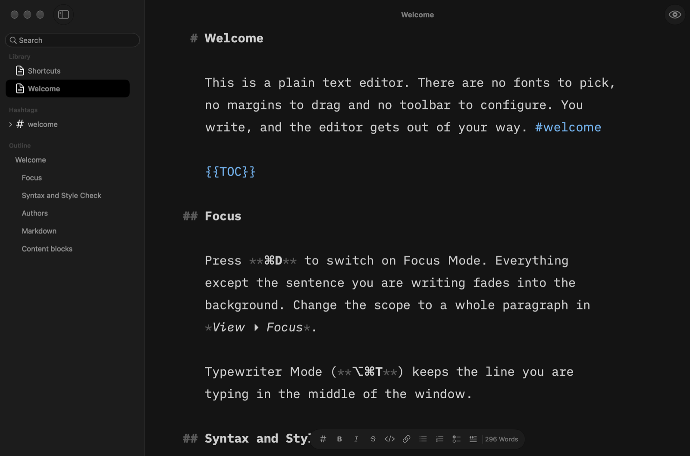

<h1 align="center">Writer</h1>

<p align="center">
  <b>A simple markdown editor.</b><br>
  No distractions, just you and your words.
</p>

<p align="center">
  
  
  
  <a href="https://github.com/sam-b-rose/writer-web"></a>
</p>

<p align="center">
  
</p>

Writer is a native AppKit take on iA Writer: plain text, calm typography, focus mode. It reads and writes ordinary Markdown files in whatever folder you want. There is also a browser version – [writer-web](https://github.com/sam-b-rose/writer-web).

## Install

```sh
brew tap sam-b-rose/writer-mac https://github.com/sam-b-rose/writer-mac
brew install --cask sam-b-rose/writer-mac/writer
```

Or build it yourself (needs the Xcode Command Line Tools).

```sh
./build.sh && open build/Writer.app
```

The first launch creates `~/Documents/Writer` with a welcome document. Pick another folder with File ▸ Choose Library Folder.

## Tour

### Focus Mode (⌘D)

Everything except the sentence you're writing fades out. Widen the scope to a paragraph in *View ▸ Focus*. **Typewriter Mode** (⌥⌘T) pins the active line to the middle of the window. **One Sentence Per Line** adds a new line after every sentence without starting a new paragraph. This setting was inspired by Derek Sivers' advice of writing [one sentence per line](https://sive.rs/1s): it helps you judge each sentence on its own and vary sentence length.

<p align="center"></p>

### Syntax highlighting

Enable **syntax highlighting** to see various parts of speech. Spot a long run of adverbs or a pile of nouns. Use **style check** to strikes through fillers, clichés and redundancies. Notice in the screenshot how it caught "actually", "basically" and "added bonus".

Paste with ⇧⌘V to mark the text as **AI-written**. Characters you type into it become yours. You can add multiple authors to denote which text came from whom (or AI).

<p align="center"></p>

### Preview (⌘R)

The Preview renders KaTeX math, footnotes, callouts, tables, task lists and content blocks. Add your own styles by creating a `.css` file in the templates folder.

<p align="center"></p>

### And the rest

- Library sidebar with search, hashtags and outline
- Wiki-style links between notes: `[[Shortcuts]]`
- Tabbable Tables with sort and align
- `/file.md` embeds Markdown, images, CSV and code
- Export to HTML, PDF and Word
- Supports light, sepia, dark, and dusk appearances

## Customizing

- Preview templates: add a `.css` file into `~/Library/Application Support/Writer/Templates` (accessible via View ▸ Template in the menu).
- Style Check: View ▸ Style Check ▸ Edit Custom Patterns, then add one phrase per line.
- Authorship lives in a footer block at the end of each file (`Annotations:` with a SHA-256 of the text).

## Notes

Release zips are ad-hoc signed (sorry, not ready to pay for that Apple Developer license yet). On first launch you need System Settings ▸ Privacy & Security ▸ Open Anyway. The Homebrew cask removes the quarantine flag itself.

## Contributing

See [AGENTS.md](AGENTS.md) for the code layout and dev workflow, and [docs/RELEASING.md](docs/RELEASING.md) for cutting a release.
