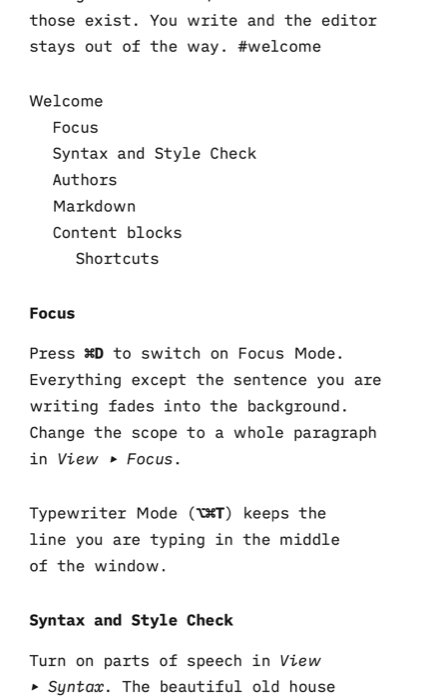

<h1 align="center">Writer</h1>

<p align="center">
  <b>A Markdown editor that gets out of your way.</b><br>
  There's no font picker, no draggable margin and no toolbar to configure,<br>
  so the only thing left to do is write. It'll flag the "very"s you let slip through.
</p>

<p align="center">
  
  
  
  <a href="https://github.com/sam-b-rose/writer-web"></a>
</p>

<p align="center">
  
</p>

Writer is a native AppKit take on iA Writer: plain text in, calm typography out. It reads and writes ordinary Markdown files in a folder you choose, so your notes outlive the app. The browser version lives in [writer-web](https://github.com/sam-b-rose/writer-web).

## Install

```sh
brew tap sam-b-rose/writer-mac https://github.com/sam-b-rose/writer-mac
brew install --cask sam-b-rose/writer-mac/writer
```

Or build it yourself; the Xcode Command Line Tools are enough, and full Xcode isn't required:

```sh
./build.sh && open build/Writer.app
```

The first launch creates `~/Documents/Writer` with a welcome document. Pick another folder with File ▸ Choose Library Folder.

## Tour

### Focus Mode (⌘D)

Everything except the sentence you're writing fades out, so the urge to reread the last paragraph has nothing to grab onto. Widen the scope to a paragraph in *View ▸ Focus*; Typewriter Mode (⌥⌘T) pins the active line to the middle of the window.

<p align="center"></p>

### Syntax highlighting for your prose

Parts of speech get their own colors, which makes a run of adverbs or a pile of nouns easy to spot. Style Check strikes through fillers, clichés and redundancies; in the screenshot it caught "actually", "basically" and "added bonus". It's rude, and it's right.

Paste with ⇧⌘V and Writer marks the text as AI-written and colors it. Characters you type into it become yours. The authorship lives in the file itself, so it travels with the document.

<p align="center"></p>

### Preview (⌘R)

A WebKit preview renders KaTeX math, footnotes, callouts, tables, task lists and content blocks. For your own look, drop a `.css` file into the templates folder.

<p align="center"></p>

### And the rest

- Library sidebar with search, hashtags and a live outline
- Wiki-style links between notes: `[[Shortcuts]]`
- Tables you can Tab through, sort and align
- `/file.md` embeds Markdown, images, CSV and code
- iA Writer Mono, Duo and Quattro bundled in
- Export to HTML, PDF and Word
- Light and dark, because of course

## Customizing

- Preview templates: drop a `.css` file into `~/Library/Application Support/Writer/Templates`; it appears under View ▸ Template.
- Style Check: View ▸ Style Check ▸ Edit Custom Patterns, one phrase per line.
- Authorship lives in a footer block at the end of each file (`Annotations:` with a SHA-256 of the text). If you change the text in another editor, Writer ignores the block.

## Notes

Release zips are ad-hoc signed, so on first launch you need System Settings ▸ Privacy & Security ▸ Open Anyway. The Homebrew cask removes the quarantine flag itself.

## Contributing

See [AGENTS.md](AGENTS.md) for the code layout and dev workflow, and [docs/RELEASING.md](docs/RELEASING.md) for cutting a release.
